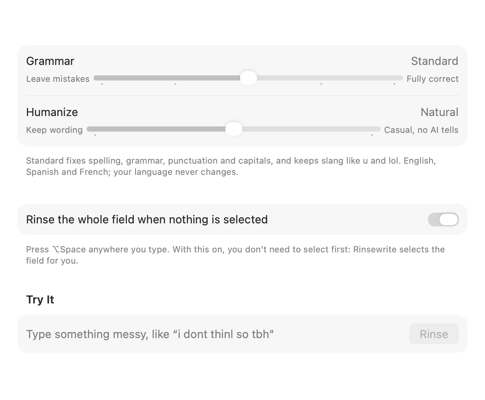

<div align="center">


# Rinsewrite

**Messy typing in, clean text out.**

A native menu bar app that fixes the text you're typing, in any app, with one shortcut and a language model that runs on your Mac.


<a href="LICENSE"></a>
<a href="https://github.com/Bruno-Alumn/Rinsewrite/actions/workflows/test.yml"></a>

[Features](#features) · [Install](#install) · [Using Rinsewrite](#using-rinsewrite) · [Troubleshooting](#troubleshooting) · [Privacy](#privacy) · [Contribute](#contribute)

</div>

---

Rinsewrite sits in your menu bar. Type a message the way you actually type,
press <kbd>⌥</kbd><kbd>Space</kbd>, and the text in front of you is replaced
with a corrected version in about a quarter of a second. Two sliders decide
how far it goes, from leaving your casual style alone to fully formal
writing, and nothing you type ever leaves your Mac.

<div align="center">
  <picture>
    <source media="(prefers-color-scheme: dark)" srcset="docs/screenshots/rinse-dark.png">
    
  </picture>
</div>

## Features

**One shortcut, any app**

- <kbd>⌥</kbd><kbd>Space</kbd> rinses the selection, or the whole text field
  when nothing is selected. Change the keys in Settings.
- Works wherever you type: WhatsApp, Slack, Mail, Notes, browsers.
- Your clipboard is put back afterwards, and <kbd>⌘</kbd><kbd>Z</kbd> in
  the app undoes a rinse.

**As much or as little as you want**

- **Grammar** in five steps: Minimal leaves small, natural mistakes; Formal
  gives complete, correct sentences.
- **Humanize** in three steps removes AI-writing tells (em dashes,
  buzzwords, "Great question!") without changing what you said.
- English, Spanish and French. Rinsewrite keeps your language and never
  translates.
- Built for fast typing: "danm i reely wany know" becomes "Damn, I really
  want to know."

**On your Mac only**

- Runs LiquidAI's LFM3 1.7B with Apple's MLX. No account, no cloud, no API key.
- About 0.1 to 0.5 seconds for a typical message, about 1.5 GB of memory
  while loaded, and an option to free it when you're not using it.

## Install

1. Install the Xcode command line tools and [uv](https://docs.astral.sh/uv/).
2. Clone the repository and run `make engine`. It installs MLX and
   downloads the model, about 1 GB, once.
3. Run `make install`, then grant the [Accessibility permission](#permissions)
   it asks for.

Rinsewrite runs on Apple silicon Macs with macOS 13 or later.

> **A note about signing:** builds made on the maintainer's Mac are signed
> with a Developer ID, so your permission carries over from one build to the
> next. Builds made elsewhere are signed ad-hoc and ask for Accessibility
> again after each rebuild. A notarized download is coming with the first
> release.

## Using Rinsewrite

1. Click into any text field and type.
2. Press <kbd>⌥</kbd><kbd>Space</kbd>. The text is rinsed in place.
3. Open the menu bar menu to change how much it fixes.

| Action | What it does |
|:--|:--|
| <kbd>⌥</kbd><kbd>Space</kbd> | Rinse the selection, or the whole field (change it in Settings › Shortcut) |
| Click the menu bar icon | Status, the Grammar and Humanize sliders, rinse the whole field |
| <kbd>⌘</kbd><kbd>,</kbd> in the menu | Open Settings |
| <kbd>⌘</kbd><kbd>Z</kbd> in the app | Undo a rinse |

The first line of the menu always says what Rinsewrite is doing: ready,
loading the model, or what it needs from you.

<details>
<summary><strong>The sliders, step by step</strong></summary>
<br>

| Grammar | What it does |
|:--|:--|
| **Minimal** | Fixes only garbled words. Keeps lowercase, missing apostrophes and slang. |
| **Light** | Fixes spelling, apostrophes, accents and wrong words (their, they're). |
| **Standard** | Fixes grammar, punctuation and capitals. Keeps slang like u and lol. |
| **Polished** | Also writes out abbreviations and smooths awkward phrasing. |
| **Formal** | Complete, correct sentences without slang. |

| Humanize | What it does |
|:--|:--|
| **Off** | Keeps your wording and sentence structure. |
| **Natural** | Removes AI-writing tells in your own voice. |
| **Casual** | Plain, short and conversational, the way a person texts. |

Text that already sounds human stays as it is at every Humanize step.

</details>

## Troubleshooting

<details>
<summary><strong>Nothing happens when I press the shortcut</strong></summary>

Open the menu bar menu. Its first line says if Accessibility access is
missing or the model is still loading. If Rinsewrite is switched on in
System Settings › Privacy & Security › Accessibility but the menu still asks
for access, open Settings and click **Reset…**, then allow it again.

If Settings › Shortcut says another app uses the keys, choose different ones.
</details>

<details>
<summary><strong>"Engine not installed"</strong></summary>

Run `make engine` in the Rinsewrite folder. It sets up Python with MLX in
`~/Library/Application Support/Rinsewrite` and downloads the model.
</details>

<details>
<summary><strong>The result changed what I meant</strong></summary>

Move **Grammar** or **Humanize** one step to the left, and undo with
<kbd>⌘</kbd><kbd>Z</kbd>. Rinsewrite checks every result for invented
words, a changed language and a swapped speaker, and retries or leaves your
text alone when it finds one, but a 1.7B model still gets some sentences
wrong.
</details>

<details>
<summary><strong>Something else</strong></summary>

**Settings › General › Report a Problem…** opens a new issue with your
Rinsewrite and macOS versions filled in. **Open Log** shows the engine's log.
</details>

## Privacy

Rinsewrite has no accounts, analytics or telemetry, and it never sends what
you type anywhere. The text you rinse goes from the app to the engine
process on your Mac and back; neither keeps it.

Its only network requests happen when you run `make engine`: Python
packages from PyPI and the model from Hugging Face.

### Permissions

| Permission | Why it's needed |
|:--|:--|
| **Accessibility** | Lets Rinsewrite press ⌘C and ⌘V for you, to copy your text and paste the rinsed version back. |

## Contribute

- **Found something broken?** Use **Settings › General › Report a Problem…**,
  or [open an issue](https://github.com/Bruno-Alumn/Rinsewrite/issues/new).
- **Want to help?** Fork the repository and open a pull request against
  `main`. Run `make test` first, and `make eval` if you changed the engine.

Much of Rinsewrite was built with AI coding agents, then compiled, tested and
exercised on real hardware before merging. AI-assisted contributions are
welcome on the same terms as any other: say what you changed and be honest
about what you tested.

<details>
<summary><strong>Build from source</strong></summary>
<br>

You need the Xcode command line tools and uv.

```sh
git clone https://github.com/Bruno-Alumn/Rinsewrite.git
cd Rinsewrite
make engine    # once: Python with MLX, and the model
make install   # build, copy to /Applications and open
```

```sh
make test         # unit tests and a launch check
make eval         # typo, language and meaning-drift checks against the real model
make train        # fine-tune the LoRA adapter (about 75 minutes on an M1 Max)
make icon         # redraw the app icon
make screenshots  # render the settings window for this README
make dmg          # dist/Rinsewrite-<version>.dmg
```

How releases are signed and notarized: [docs/RELEASING.md](docs/RELEASING.md).

</details>

<details>
<summary><strong>Architecture</strong></summary>
<br>

- The app (`Sources/Rinsewrite`) is SwiftUI. `AppState` holds the settings
  and runs a rinse: `TextReplacer` presses ⌘C (and ⌘A when nothing is
  selected), `EngineClient` sends the text to the engine, and the result is
  pasted back with your clipboard restored.
- The engine (`engine/`) is a Python process on MLX that keeps the model
  loaded and talks JSON lines over stdin and stdout.
- Each of the 15 slider combinations has its own prompt. The current and
  previous ones stay pre-filled, so a rinse only processes your text.
- Decoding uses your own words as a draft and checks several tokens per
  step. LFM3's convolution and sliding-window caches are rewound by hand
  when a draft is rejected, so the output matches plain decoding.
- Before the model sees your text, rare words get spelling suggestions from
  a 50,000-word list per language. Afterwards, a check catches invented
  words, a swapped speaker and a changed language, and retries.

</details>

<details>
<summary><strong>Performance</strong></summary>
<br>

Measured on an M1 Max:

| Metric | Value |
|---|---|
| Typical message | about 0.1 to 0.5 s |
| 800-character message | about 1 to 1.5 s |
| Memory, model loaded | about 1.5 GB |
| Memory, model freed | about 0.3 GB |
| App, without the engine | about 80 MB, 2.7 MB on disk |

</details>

<details>
<summary><strong>Fine-tuning</strong></summary>
<br>

`finetune/` holds about 560 hand-written chat messages in English, Spanish
and French, each with its correction at every Grammar step, plus 40
AI-sounding texts with natural and casual rewrites. `build_dataset.py` adds
fast-typing typos and renders them in the app's prompt; `train.py` trains a
LoRA adapter; `eval_valid.py` scores held-out messages. An adapter goes in
`engine/adapter/` and ships only when it beats the prompt-only model on
every check in `make eval`.

</details>

<details>
<summary><strong>Project documentation</strong></summary>
<br>

| Document | What's inside |
|:--|:--|
| [Changelog](CHANGELOG.md) | What changed in each version |
| [Releasing](docs/RELEASING.md) | Signing, notarization and publishing |

</details>

---

Rinsewrite runs [LFM3 1.7B](https://huggingface.co/LiquidAI/LFM3-1.7B-MLX-4bit)
by Liquid AI, under its own license, through [MLX-VLM](https://github.com/Blaizzy/mlx-vlm).
The Humanize rules are a short version of
[blader/humanizer](https://github.com/blader/humanizer) (MIT).

**MIT License:** © 2026 Bruno-Alumn. See [LICENSE](LICENSE).

<sub>More Mac apps by Bruno-Alumn: [SolStream](https://github.com/Bruno-Alumn/SolStream) · [Tuckaway](https://github.com/Bruno-Alumn/Tuckaway) · [ThockBox](https://github.com/Bruno-Alumn/ThockBox)</sub>
